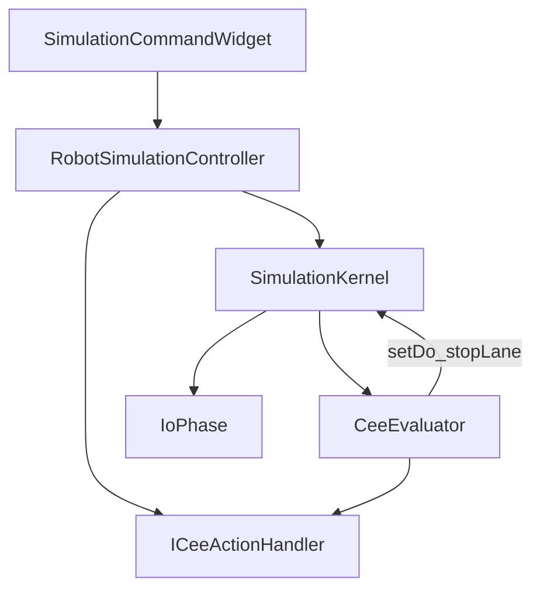

# DESIGN — 仿真事件模式（薄 CEE）

## 1. 分层

## 2. 每拍时序（EventBased）

1. `LogicalClock::advance`
2. 已运行 Lane `step`（读上一拍 DI）
3. `IDeviceMotionTicker::tick`
4. `IoPhase::latchAfterPropagate` + `swapAll`（含网络全部 Owner 端口采样）
5. `CeeEvaluator::evaluate` → setDo / stopLane / Handler 启姿态或机器人程序
6. `CollisionGuard`

TimeBased：跳过步骤 5；Driver 保持连接。

## 3. 核心类型

| 类型 | 职责 |
|------|------|
| `SimRunMode` | TimeBased / EventBased |
| `CeeRule` | when + do[] |
| `CeeEvaluator` | 边沿记忆 + 规则求值 |
| `ICeeActionHandler` | goNamedPose / startRobotProgram（Controller 实现） |

## 4. 工程 JSON

- `simulationRunMode`：`"timeBased"` \| `"eventBased"`
- `ceeRules`：规则数组
- `devicePrograms`：既有 DeviceProgramStore 形状
