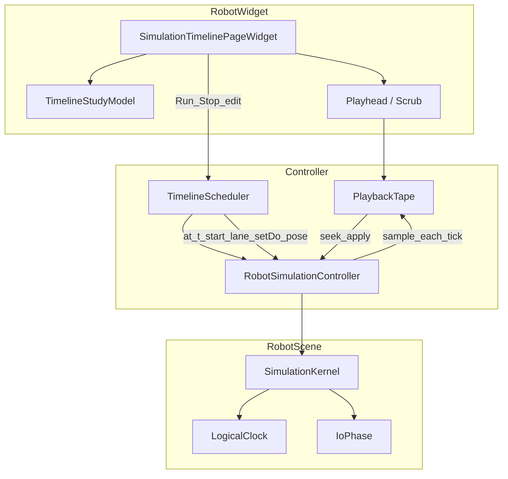

# DESIGN — 仿真时间轴编排

## 1. 整体架构



## 2. 分层与组件

| 组件 | 职责 |
|------|------|
| `TimelineStudyModel` | tracks/clips、duration、选中态；JSON 序列化 |
| `SimulationTimelinePageWidget` | 多轨绘制、拖片段、拖播放头、工具条 Run/Stop/录制策略 |
| `TimelineScheduler` | 按 `simTimeSec` 边沿触发：startRobotProgram / goNamedPose / setDo / apply material keyframe |
| `PlaybackTape` | `vector<TapeFrame>`：t、关节/设备角、信号快照、物料位姿；seek 应用 |
| Controller 门闩 | 与指令 Run、EventBased、外置控制器互斥 |

## 3. 数据模型

```json
{
  "timelineStudy": {
    "version": 1,
    "durationSec": 30.0,
    "sampleHz": 20,
    "tracks": [
      {
        "id": "...",
        "type": "robot",
        "name": "R1",
        "instanceIndex": 0,
        "clips": [
          { "id": "...", "tStart": 0.0, "tEnd": 5.2, "programId": "main" }
        ]
      },
      {
        "id": "...",
        "type": "device",
        "ownerId": "dev-uuid",
        "clips": [
          { "id": "...", "tStart": 1.0, "tEnd": 2.5, "poseId": "open", "durationSec": 1.5 }
        ]
      },
      {
        "id": "...",
        "type": "signal",
        "ownerId": "...",
        "signal": "Start",
        "direction": "out",
        "clips": [
          { "id": "...", "tStart": 0.8, "tEnd": 1.0, "value": true }
        ]
      },
      {
        "id": "...",
        "type": "material",
        "objectId": "geom-uuid",
        "clips": [
          {
            "id": "...",
            "tStart": 2.0,
            "tEnd": 2.0,
            "visible": true,
            "pose": { "x": 0, "y": 0, "z": 0, "qw": 1, "qx": 0, "qy": 0, "qz": 0 }
          }
        ]
      }
    ]
  }
}
```

- `material` 的 `tStart==tEnd` 表示关键帧；相邻关键帧之间 **线性插值位姿**，`visible` 在关键帧处阶跃（或 hold 上一帧）
- `signal` 窗：`[tStart,tEnd)` 内保持 `value`，离开恢复 false（MVP；可后续加 hold）

## 4. 运行时序

### 4.1 Timeline Run（编排）

1. 校验：非 EventBased、非外置控制器独占、非指令页 session
2. `PlaybackTape.clear`；`LogicalClock.reset`
3. 每 tick：`Scheduler::onSimTime(t)`  
   - 进入 clip：触发动作（程序/姿态/setDo）  
   - 物料：按关键帧表插值写 document/OSG  
4. 每 tick 末：采样写入 Tape  
5. `t >= durationSec` 且无 Lane 忙 → 停或循环（MVP：**停**）

### 4.2 Scrub

1. 若 Tape 覆盖目标 `t`：`Tape.apply(t)` → 关节/设备/信号显示/物料位姿  
2. 若未覆盖：播放头可动，3D 保持最近帧 + UI 提示「先播放采样」  
3. Scrub **不**启动新 Lane（避免半截运动）；物料/信号显示以 Tape 为准

### 4.3 与 Kernel

- 运动仍经 `startRobotLane` / device ticker；Scheduler 只负责**何时**调 Controller 已有 API  
- Seek **不**回放历史 SET_DO 到真实 PLC；仅本地 sink/显示（ExternalPlc 会话本页只读）

## 5. UI 草图

```
[Run][Stop]  t=12.40 / 30.00  [====playhead====]  rate
─────────────────────────────────────────────────
R1 (robot)   |####prog####|        |##|
DevA (device)|  |pose|                 |
DO Start     | ▂▂|                     |
Mat Part1    |●----●----●              |
```

- 左栏轨名 + 类型色；右栏可滚轮缩放时间尺
- 拖片段改时间；Shift 拖微调；双击打开引用选择（program/pose/object）

## 6. 异常与互斥

| 情况 | 策略 |
|------|------|
| 指令 Run 中点时间轴 Run | 拒绝 + 提示先 Stop |
| EventBased 中编辑 | 只读 |
| 片段重叠同实例机器人 | 拒绝落盘或后写覆盖前写并警告（锁定：**拒绝重叠提交**） |
| Tape 内存 | duration×Hz 过大时降采样或封顶（如 120s@20Hz） |

## 7. 模块落点

| 模块 | 内容 |
|------|------|
| RobotWidget | Page / Model / Scheduler / Tape / Dock 挂载 |
| RobotScene | 尽量不改；若需 `clock.setSimTimeForUi` 仅 Tape 显示用，不伪装 tickIndex |
| Widget | `MainWindowProjectIo` 读写 `timelineStudy` |
| 文档 | 本目录 6A；features README 索引一行 |
