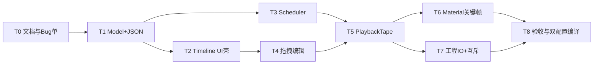

# TASK — 仿真时间轴编排

## 依赖图

## 原子任务

### T0 — 文档冻结 + BugTracker ✅ #70
### T1 — TimelineStudyTypes + JSON ✅
### T2 — SimulationTimelinePageWidget + Dock Timeline 模式 ✅
### T3 — TimelineScheduler ✅
### T4 — 多轨拖拽编辑 ✅
### T5 — PlaybackTape + scrub ✅
### T6 — Material 关键帧 ✅
### T7 — 工程 IO + 运行互斥 ✅
### T8 — ACCEPTANCE + 编译 ✅

## 实现约束（全局）

- 风格对齐 RobotWidget；注释纯中文、只写 Why
- 不改 ProcessFlow 工作区
- 不扩大到 Appearance 物理
