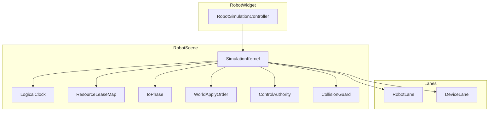

# DESIGN — 仿真统一内核

## 1. 分层

## 2. 核心类型

| 类型 | 职责 |
|------|------|
| `ParticipantId` | `Robot(instanceIndex)` / `Device(backendId)` |
| `LogicalClock` | `tickIndex`、`simTimeSec`、`playbackRate` |
| `IoPhase` | prev/next Sample 双缓冲；边沿锁存 |
| `ResourceLeaseMap` | `tryAcquire` / `release`；冲突返回 false → Lane Abort |
| `WorldApplyOrder` | 挂载 DAG 拓扑序 Apply |
| `RobotLane` / `DeviceLane` | 包装/泛化程序状态机 |
| `ControlAuthority` | Kernel vs External(i) |
| `CollisionGuard` | FreezeLane / StopAll |

## 3. 每拍时序

1. `stepMotors(dt)` — 读 **prev** Sample
2. `commitOutputs` — SET_DO/AO
3. `propagate` — DO→DI
4. `latchToNextSample`
5. `resolveBarriers`
6. Lease 校验（失败 Abort Lane）
7. `WorldApplyOrder::apply`
8. `CollisionGuard::evaluate`（P5）
9. UI 反馈

## 4. 资源键

- `device:{backendId}`
- `deviceAxis:{backendId}:{axisIndex}`
- `extAxis:{instance}:{axisIndex}`
- `workpiece:{backendId}`

挂载设备全身租约默认归载机 RobotLane；DeviceLane 仅租轴级键。

## 5. 工程 JSON

- `devicePrograms`：按 device backendId 的 Catalog 子集
- 会话隐含 `ioSampleDelay=nextTick`（文档约定，可侧车注明）

## 6. 异常

| 情况 | 处理 |
|------|------|
| 租约失败 | 该 Lane Aborted + summary |
| Barrier 超时 | 等待中的 Lane Abort |
| 规划失败 | 沿用现 Executor：播到失败点前停该 Lane |
| 外置占用 | Run All 排除该实例并提示 |
