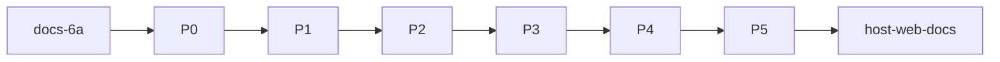

# TASK — 仿真统一内核

## T-docs：6A 文档

- 输入：计划锁定决策
- 输出：ALIGNMENT/CONSENSUS/DESIGN/TASK/ACCEPTANCE
- 验收：目录齐全，决策与计划一致

## T-P0：Kernel 骨架

- 输入：现有 RobotProgramExecutor、Controller tick、DevicePoseMotionPlayer
- 输出：SimulationKernel、LogicalClock、IoPhase、RobotLane；Player 无独立 QTimer；Controller 调 kernel.tick
- 验收：单机 Run 等价；双配置编译

## T-P1：多 RobotLane

- 输入：P0 Kernel
- 输出：多 Lane、Run All、Lease Abort、规划分桶、Stop All
- 验收：两机并行；抢设备 Abort

## T-P2：DeviceLane

- 输入：P1
- 输出：devicePrograms、GoNamedPose 等、DI 走 Lane、Done DO
- 验收：信号闭环；统一 Stop

## T-P3：ApplyOrder

- 输入：P2、挂载元数据
- 输出：WorldApplyOrder DAG；挂载租约归载机
- 验收：挂载无闪裂

## T-P4：SyncBarrier

- 输入：P3
- 输出：Barrier 指令生效；WaitingBarrier UI；全局倍率
- 验收：多 Lane 对齐放行

## T-P5：Authority + CollisionGuard

- 输入：P4、ControllerManager、BackendCollisionSync
- 输出：按实例 Authority；FreezeLane/StopAll
- 验收：无双写；碰撞策略可复现

## T-host：对齐与文档收尾

- 输出：IIoSignalNetwork、DEVELOPER_GUIDE、ACCEPTANCE 勾选、FINAL/TODO
