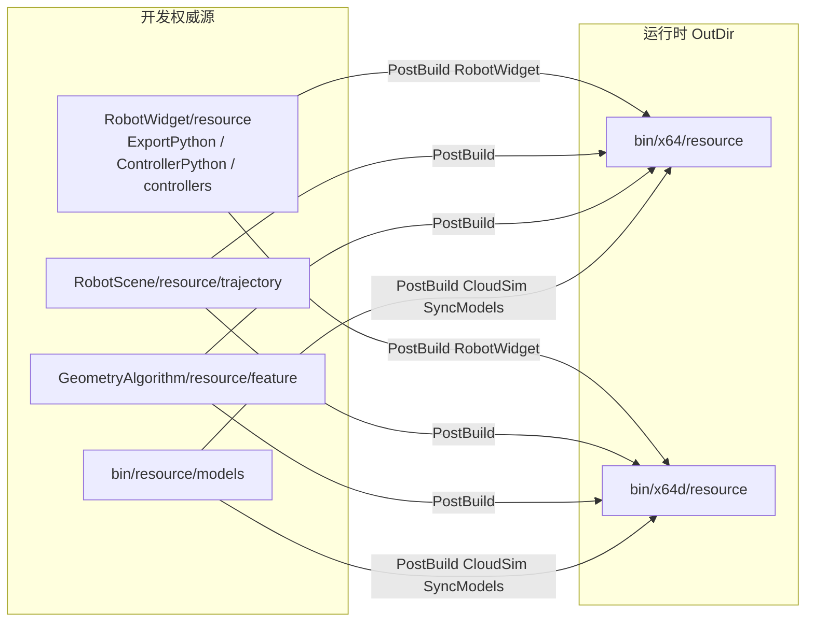

# DESIGN — 资源路径统一

## 1. 整体结构

## 2. 核心变更点

| 组件 | 变更 |
|------|------|
| 文件系统 | 迁并删除 `CloudSim/resource`；删 `bin/resource/{Python,trajectory}` |
| `RobotWidget.vcxproj` | Controller 源改为 `$(ProjectDir)resource\...` |
| `CloudSim.vcxproj` | 新增 `SyncSharedModels` → OutDir |
| `ExternalControllerDialog.cpp` | 回退路径改 RobotWidget |
| `collect-deps.ps1` | SharedResource 仅 models 时仍可用；Desktop 可加 Controller 源 fallback |
| README / 验收文档 | 路径字符串更新 |

## 3. models 同步策略

- 源：`$(CloudSimRepoRoot)bin\resource\models`
- 目标：`$(OutDir)resource\models`
- 实现：PowerShell `Copy-Item -Recurse -Force` 或 MSBuild `Copy` + 递归 ItemGroup；存在源目录才执行。
- 体积大：SkipUnchangedFiles / 仅拷贝变更；不改 OutDir 定义。

## 4. 异常

- 无 `bin\resource\models`：同步跳过，不失败构建（与缺模型时测试 skip 一致）。
- 缺 Controller 源：Copy 条件 `Exists`，与现逻辑一致。
