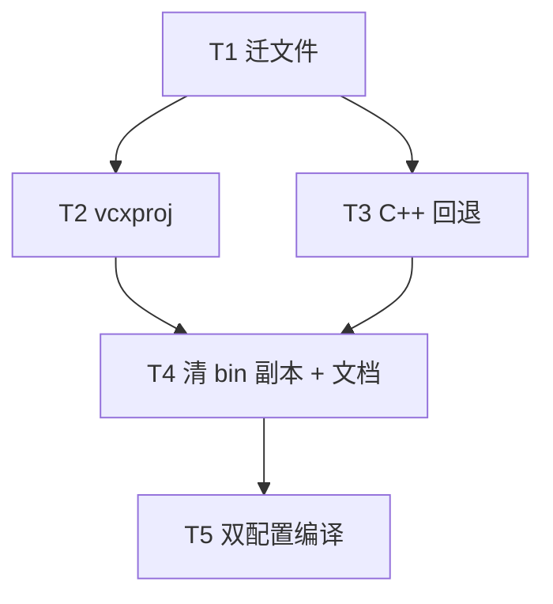

# TASK — 资源路径统一

## 依赖图

### T1 — 迁移源树
- **输入**：`CloudSim/resource/**`
- **输出**：合并入 `RobotWidget/resource/`；删除 `CloudSim/resource`
- **验收**：新路径存在；旧路径不存在

### T2 — 构建拷贝与 models 同步
- **输出**：RobotWidget 路径修正；CloudSim `SyncSharedModels`
- **验收**：PostBuild 目标路径正确

### T3 — 对话框回退
- **输出**：`ExternalControllerDialog.cpp` 指向 RobotWidget
- **验收**：无 `CloudSim/resource` 字符串

### T4 — 清理与文档
- **输出**：删 `bin/resource/Python`、`trajectory`；更新关键 README/验收；打包 fallback 如需
- **验收**：`bin/resource` 仅 `models`

### T5 — 编译
- **验收**：RobotWidget + CloudSim Debug|x64 与 Release|x64 成功
