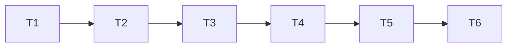

# TASK — 多视角页面

## T1 文档与提单
- 输出：ALIGNMENT/CONSENSUS/DESIGN/TASK；#35 in_progress
- 验收：文件存在；BugTracker 状态正确

## T2 SatelliteOsgView
- 输入：共享场景根、可选 shareContext
- 输出：独立 Viewer/Trackball；setViewDirection；cameraMatrix
- 验收：可旋转缩放；方向预设生效

## T3 MultiViewShell + DocumentHost
- 输入：Primary OsgWidget
- 输出：布局切换；活动格高亮；卫星创建/销毁
- 验收：1↔2↔4；场景一致

## T4 DetachedViewWindow
- 输出：浮动窗；文档关闭销毁；最多 2
- 验收：并存观察；关文档窗消失

## T5 Chrome / i18n / 持久化
- 输出：视图菜单；中英；QSettings 轻量存 layout
- 验收：菜单可用；语言切换字符串正确

## T6 编译验证
- Debug|x64 + Release|x64：CloudSimHost / DesktopViewport / Widget
- 验收：两配置成功

