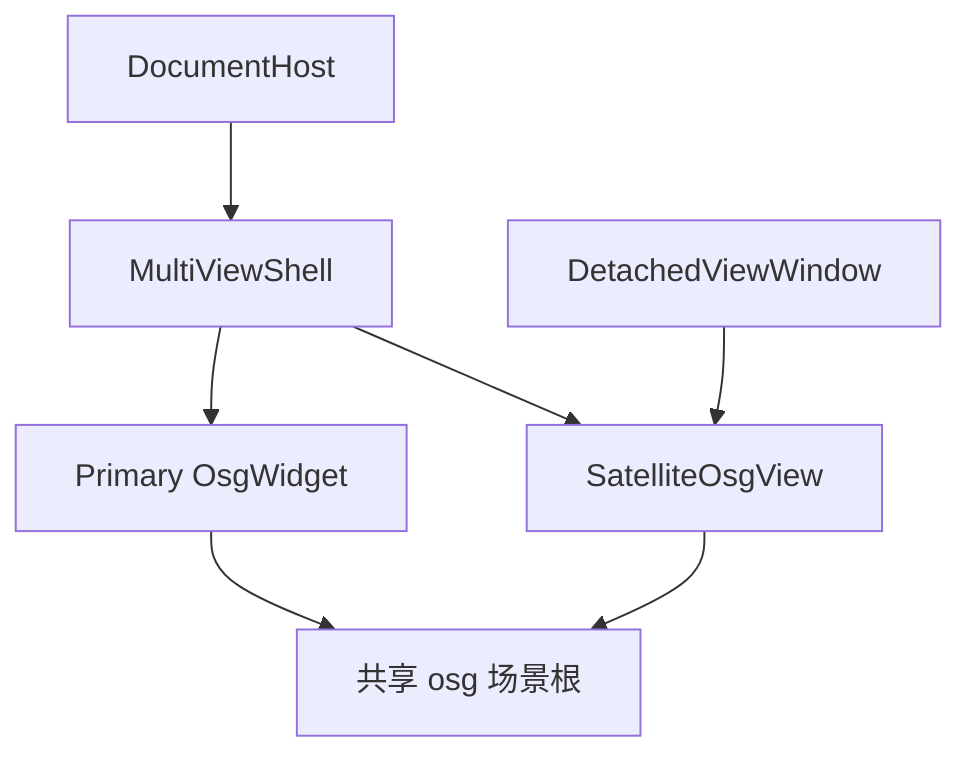

# 多视角页面

## 架构



## 组件

| 组件 | 位置 | 职责 |
|---|---|---|
| `SatelliteOsgView` | CloudSimHostDesktopViewport | 轻量 OSG 窗，共享根 + Trackball |
| `MultiViewShell` | 同上 | QSplitter 1/2/4；活动格；装 Primary/卫星 |
| `DetachedViewWindow` | 同上 | QDialog 浮动视角，文档关闭销毁 |
| Flavor hooks | HostOsgFlavorHooks_* | Desktop 创建 Shell；Headless nullptr |
| DocumentHost | Core | 持有 Shell；API；render/osgView 仍指 Primary |

## 接口契约

```cpp
enum class MultiViewLayout { Single, SplitH, SplitV, Quad };
void DocumentHost::setMultiViewLayout(MultiViewLayout);
MultiViewLayout DocumentHost::multiViewLayout() const;
int DocumentHost::activeViewIndex() const;
bool DocumentHost::openDetachedViewWindow(); // false if at cap
```

## 异常 / 限制

- 无 Shell（Headless）时布局 API no-op
- 共享 GL context 失败则仍可创建卫星（性能较差）
- 卫星 on-demand 刷新；SingleThreaded frame
