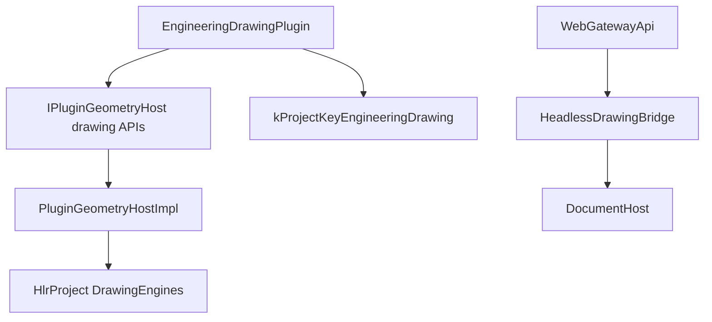

# DESIGN — 工程图模块清理

## 删除边界

以上节点全部拆除；模式切换仅保留几何/工艺等其它模式。

## 分层改动

| 层 | 动作 |
|----|------|
| Plugins | 删 EngineeringDrawingPlugin 目录与 sln 项 |
| Geometry | 删 Hlr/Drawing* 源与 vcxproj 项 |
| SDK | 删出图虚函数与类型；HOST 版本 +1 |
| Host | 删实现、Bridge、模式优先列表项 |
| Web | 删 sidecar bridge 调用 |
| Docs/Help | 去引用、删 drawing.html 与专题目录 |

## 异常/兼容

- 旧工程侧车字段：忽略残留
- ABI：虚表中段删除，必须抬 HOST 版本并重编全部依赖插件
