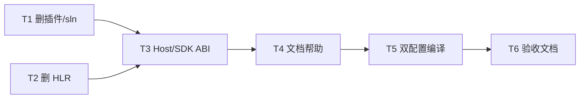

# TASK — 工程图模块清理

## 依赖图

| ID | 任务 | 验收 |
|----|------|------|
| T1 | 删插件 + sln + organize 脚本 | 目录与工程条目不存在 |
| T2 | 删 GeometryAlgorithm Drawing/HLR | vcxproj 无对应项且可编译 |
| T3 | SDK/Host/Web Bridge + 版本抬升 | grep 无活跃符号 |
| T4 | README/features/help | 无「可用工程图」表述 |
| T5 | Debug+Release 依赖链编译 | 退出码 0 |
| T6 | ACCEPTANCE/FINAL/TODO | 文档齐全 |
